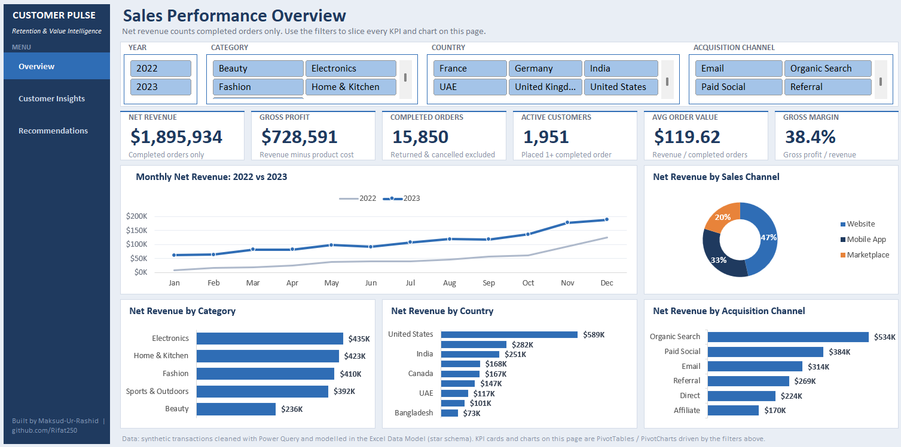
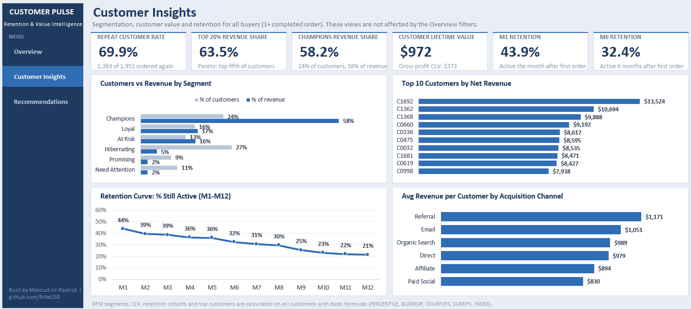
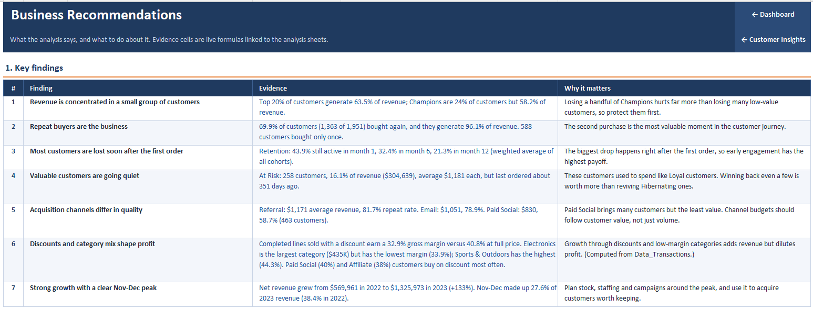
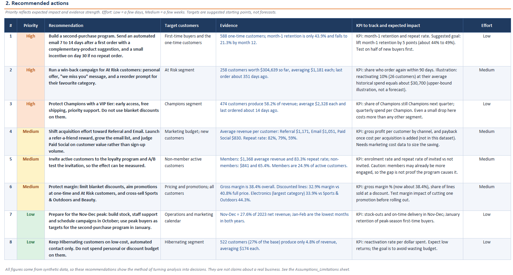

# Customer Pulse: Retention & Value Intelligence in Excel

*From messy transactions to customer decisions.*



> All data in this project is synthetic (randomly generated to behave like an online retailer, Jan 2022 to Dec 2023). The project demonstrates a method, not a real business.

## Executive Summary

An online retailer had two years of order history but no clear view of who its best customers are, how many come back, and where growth comes from. I cleaned the raw data, modelled it in Excel and built an interactive dashboard with customer segmentation, lifetime value and retention analysis, plus a prioritised action plan.

**Key results**

- Net revenue of **$1.90M** and gross profit of **$729K** (38.4% margin) from 15,850 completed orders; average order value **$119.62**
- The top 20% of customers generate **63.5%** of revenue; the 474 Champions (24% of customers) generate **58.2%**
- **69.9%** of active customers bought more than once, but retention falls from 43.9% in month 1 to **21.3%** in month 12
- Customer lifetime value is **$972** in revenue and **$373** in gross profit
- Revenue grew **133%** from 2022 to 2023, and November and December make up **27.6%** of 2023 revenue
- Discounted sales earn a **32.9%** margin against 40.8% at full price

## Business Problem

- Revenue depends on a small group of customers, but nobody knew who they were
- It was unclear how many customers buy again and how quickly they drop off
- Raw exports contained duplicates, mixed date formats and inconsistent labels, so first-pass numbers were wrong
- Marketing and discount decisions had no customer-level evidence behind them

## Methodology

1. **Clean** the raw files with Power Query: 25,566 raw order lines became 24,836 clean lines (duplicates, blank or unknown customers, invalid dates and extreme quantities removed; text prices, dates and labels standardised)
2. **Model** the data in the Excel Data Model as a star schema: Transactions (fact) linked to Customers, Products and Calendar
3. **Define** the metrics: net revenue counts completed orders only; active customer = at least one completed order (1,951); repeat customer = two or more (1,363)
4. **Analyse** with PivotTables and standard formulas:
   - RFM segmentation (recency, frequency, monetary scored 1 to 5)
   - Pareto analysis of revenue concentration
   - Customer lifetime value by acquisition channel and loyalty status
   - Month-by-month retention cohorts
5. **Present** the results in a two-page interactive dashboard with slicers, and a recommendations page

## Technical Skills Applied

Power Query, Excel Data Model (star schema), PivotTables and PivotCharts, slicers, KPI cards, lookup and dynamic-array formulas, RFM analysis, cohort retention analysis, customer lifetime value, dashboard design

## Dashboard Pages

**Overview:** six KPI cards, four slicers (Year, Category, Country, Acquisition Channel) and charts for monthly revenue, sales channel, category, country and acquisition channel.

**Customer Insights:** repeat rate, top-20% share, Champions share, CLV and retention KPIs, with segment, top-customer, retention-curve and acquisition-channel charts.



## Results & Recommendations

**What the data shows**

- Losing a few Champions would hurt far more than losing many low-value customers
- The second purchase is the key moment: customers who come back once tend to keep coming back
- Referral ($1,171 per customer) and Email ($1,051) are worth more than Paid Social ($830), and their repeat rates are higher (82% and 79% against 59%)
- Electronics is the largest category by revenue but has the lowest margin (33.9%); Sports & Outdoors has the highest (44.3%)

**What to do** (full plan with evidence, KPIs and effort on the Recommendations sheet)

1. Build a second-purchase program, an automated email 7 to 14 days after a first order, aiming to lift month-1 retention by about 5 points
2. Run a win-back campaign for At Risk customers
3. Protect Champions with a VIP tier instead of blanket discounts
4. Shift acquisition effort toward Referral and Email
5. Protect margin by limiting blanket discounts and cross-selling higher-margin categories
6. Plan stock, staffing and campaigns around the November to December peak




## Project Structure

```
customer-pulse/
├── README.md
├── Customer_Pulse.xlsx      Clean data, model, analysis sheets and dashboards
└── screenshots/             Dashboard previews
```

Main workbook sheets: Dashboard, Customer_Insights, Recommendations (presentation); Data_Customers, Data_Products, Data_Transactions (clean data); RFM, Segments, CLV, Cohort and pivot sheets (analysis).

## Author

**Maksud-Ur-Rashid**
Skills: Excel, Power BI, SQL, Python, Metabase
[GitHub](https://github.com/Rifat250) | [LinkedIn](https://linkedin.com/in/maksud-ur-rashid) | murashid11@gmail.com
