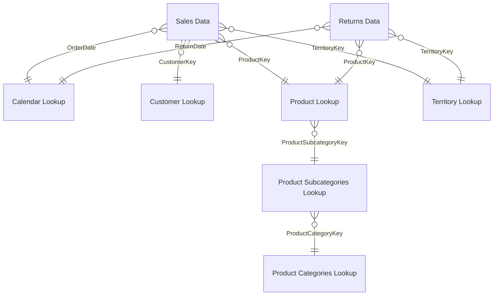

# Adventure Works Sales Analysis Dashboard

An interactive 4-page Power BI dashboard that analyzes sales, profit, orders, returns, products, customers and geography for **Adventure Works**, a bike and accessories retailer (Jan 2020 – Jun 2022).


---

## Executive Summary

Adventure Works generated **$24.91M in revenue** and **$10.46M in profit** from **25K orders** placed by **17.4K customers**, with a **2.17% return rate**. Monthly revenue rose from around **$0.5M** in early 2020 to **$1.83M** in the latest month. Accessories lead in order volume, Australia and the United States are the largest markets, and medium- and low-income customers place most of the orders.

## Business Problem

Sales, returns, product and customer data were stored in separate files, so management had no single place to answer basic questions:

- How are revenue, profit, orders and returns trending month over month?
- Which categories and products drive sales, and which are returned most?
- Which countries and regions contribute the most?
- How is each product performing against target, and how would a price change affect profit?
- Who are the most valuable customers?

This dashboard brings all of it into one interactive report.

## Methodology

1. **Data preparation (Power Query):** imported 7 CSV lookup/fact files and combined the yearly sales files with `Folder.Files`; removed junk header rows, null keys and error rows; set data types; added date attributes (Year, Month, Day Name, Start of Week/Month/Year).
2. **Data modeling:** built a **star schema** with two fact tables (Sales Data – 56,046 rows, Returns Data – 1,809 rows) and dimension tables for Calendar, Customer, Product, Product Subcategory, Product Category and Territory (one-to-many, single-direction relationships).
3. **DAX measures:** created 27 measures in a dedicated `_All Measures` table for revenue, cost, profit, orders, returns, return rate, month-over-month comparison, targets, what-if pricing and top customer.
4. **Dashboard design:** designed 4 pages with a custom theme, slide-out filter panel, page navigation, drill-through and tooltip pages.

### Data Model



### Sample DAX

```DAX
Total Revenue =
SUMX ( 'Sales Data', 'Sales Data'[OrderQuantity] * RELATED ( 'Product Lookup'[ProductPrice] ) )

Previous Month Revenue =
CALCULATE ( [Total Revenue], DATEADD ( 'Calendar Lookup'[Date], -1, MONTH ) )

Adjusted Profit = [Adjusted Revenue] - [Total Cost]   -- what-if price simulation

Top Customer =
VAR TopCustomer = TOPN ( 1, ALLSELECTED ( 'Customer Lookup'[Full Name] ), [Total Revenue], DESC )
RETURN MAXX ( TopCustomer, 'Customer Lookup'[Full Name] )
```

All measures: [`dax/measures.dax`](dax/measures.dax) · Field and what-if parameters: [`dax/parameters.dax`](dax/parameters.dax) · Calculated columns: [`dax/calculated_columns.dax`](dax/calculated_columns.dax)

## Skills Used

- **Power Query:** data cleaning, folder-based file combining, data type handling
- **Data Modeling:** star schema with two fact tables
- **DAX:** SUMX, RELATED, CALCULATE, DATEADD, DIVIDE, TOPN, ALLSELECTED, SWITCH
- **Advanced features:** field parameters, what-if parameter, drill-through, report-page tooltip, bookmarks
- **Visualization:** KPI cards, trend line, gauges, map, donut charts, matrix with conditional formatting, dynamic text

## Dashboard Pages

### 1. Executive Dashboard
KPI cards, revenue trend, orders by category, Top 10 products, and month-over-month cards. A slide-out panel filters by Year and Continent.


### 2. Map
Switch the metric (Revenue / Orders / Profit / Returns / Return %) and the level (Continent / Country / Region) with field parameters.


### 3. Product Details (Drill-through)
Gauges for revenue, orders and profit against target, a **price adjustment slider** comparing actual and adjusted profit, and a dynamic summary.


### 4. Customer Details
Customer count, revenue per customer, orders by income level and occupation, Top 100 customers and the top customer by revenue.


## Results

**Overall**
- **Revenue:** $24.91M · **Profit:** $10.46M · **Orders:** 25K · **Return Rate:** 2.17%
- **Latest month:** revenue **$1.83M** (+3.31% vs previous month), orders **2,146** (-0.88%), returns **167**
- Revenue shows a clear **upward trend** from 2020 to 2022, with the sharpest rise from mid-2021.

**Products**
- **Accessories** have the most orders (**17K**), followed by Bikes (**14K**) and Clothing (**7K**).
- **Water Bottle – 30 oz.** is the most ordered product (**3,983 orders**).
- **Road-650 Red, 52** is the most returned product.
- Among the Top 10 products, **Sport-100 Helmet Red (3.33%)** and **Blue (3.31%)** have the highest return rates.

**Geography**
- **Australia** and the **Southwest** region of the United States show the largest order volumes on the map, followed by Northwest (US), Canada, the UK, Germany and France.

**Customers**
- **17.4K customers** with an average revenue of **$1.43K per customer**.
- **Medium-income (11.6K)** and **low-income (11.1K)** customers place far more orders than high-income customers (2.2K).
- **Professional (7.9K)** and **Skilled Manual (6.0K)** customers are the leading occupation groups.
- The top customer by revenue, **Mr. Maurice Shan**, generated **$12.41K** from just **6 orders**.

**Price simulation (example)**
- For Water Bottle – 30 oz., a **20% price increase** raises adjusted profit by **31.95%** (assuming the same order volume).

## Recommendations

1. **Cross-sell accessories with bikes:** accessories are ordered most often, so bundle them with bike purchases to raise order value.
2. **Reduce returns on high-return products:** review sizing, product descriptions and quality checks for Sport-100 helmets and Road-650 Red, 52.
3. **Focus on the core markets:** prioritize Australia and the US Southwest, where order volume is highest.
4. **Target the main customer segments:** design campaigns for medium- and low-income, professional and skilled-manual customers, who place most orders.
5. **Watch order volume:** revenue grew in the latest month while orders dipped slightly, so track whether order counts recover.
6. **Test price changes before applying them:** use the price adjustment slider to check the profit impact product by product.

## Files

- `Adventure_Works_Sales_Dashboard.pbix` – Power BI report
- `dax/` – DAX measures, calculated columns and parameters
- `images/` – dashboard screenshots

## Author

**Maksud-Ur-Rashid**
Data Analyst | Power BI | Excel | SQL | Python
GitHub: [@Rifat250](https://github.com/Rifat250)
