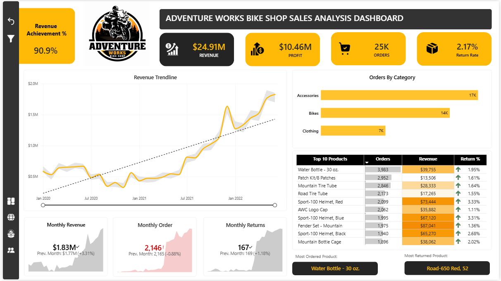
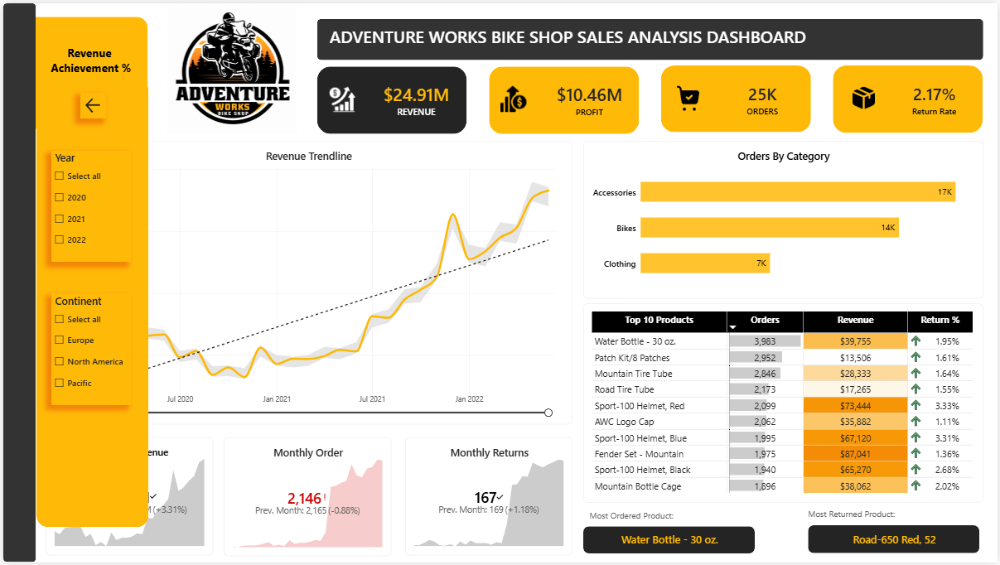
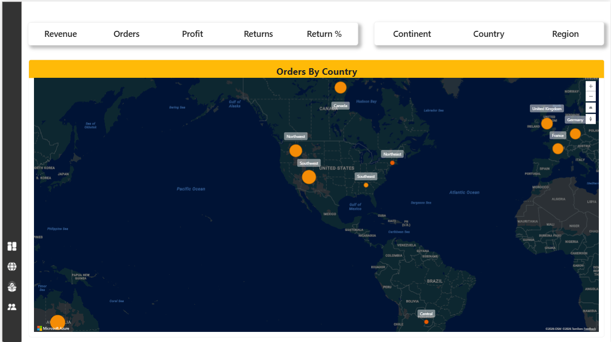
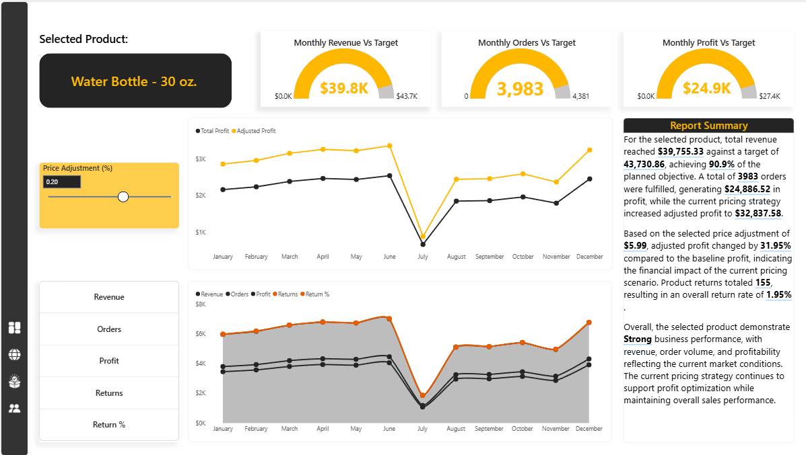
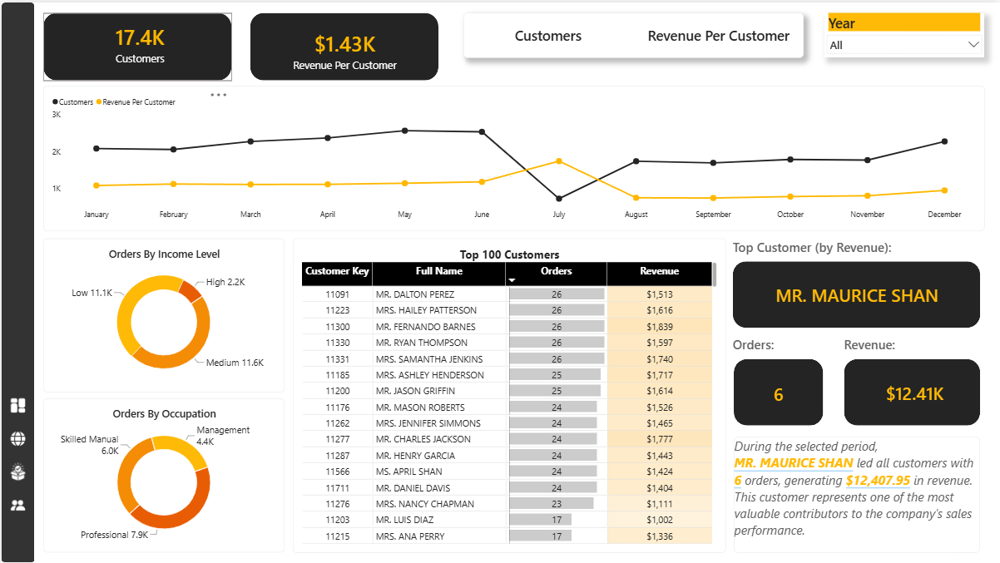
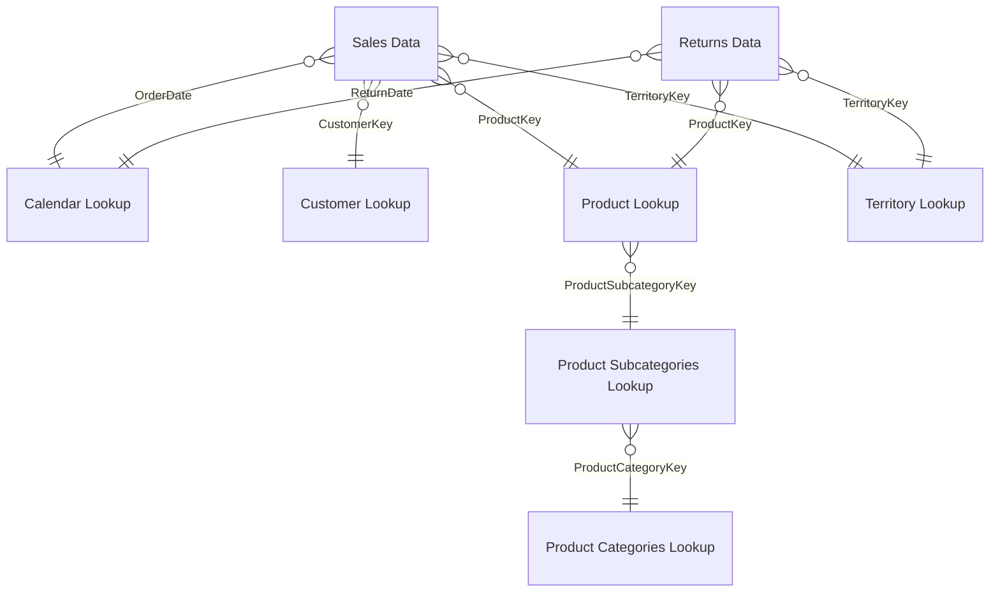

# Adventure Works Bike Shop: Sales Analysis Dashboard (Power BI)

A 4-page interactive Power BI report that tracks revenue, profit, orders and returns for **Adventure Works**, a fictional bike and accessories retailer selling in North America, Europe and the Pacific (Jan 2020 to Jun 2022).

The report goes from a company-wide view down to individual products and customers. It also includes a **what-if price simulator** that shows how a price change would affect profit.



---

## Business questions

1. How are revenue, profit, orders and returns trending, and how does this month compare with last month?
2. Which product categories and products drive order volume, revenue and returns?
3. Which countries and regions contribute the most to sales?
4. For any product, how is it performing against target, and what happens to profit if we change its price?
5. Who are the most valuable customers, and what is their income level and occupation?

## Headline numbers

| Metric | Value |
|---|---|
| Revenue | **$24.91M** |
| Profit | **$10.46M** (42% margin) |
| Orders | **25,164** |
| Customers | **17,416** |
| Return rate | **2.17%** |
| Period | Jan 2020 to Jun 2022 (912 days) |

## Key insights

- **Strong growth.** Revenue in Jan to Jun 2022 was **$9.19M**, about **3x** the same period of 2021 ($2.95M). June 2022 was the best month in the data at **$1.83M**.
- **Bikes earn the money, accessories bring the orders.** Bikes generate **95% of revenue**. Accessories appear in the most orders (17K) but give only 3.6% of revenue, though at the highest margin (**63%** vs 41% for bikes).
- **The order mix changed in 2021.** Orders grew about **4x** from 2020 to 2021 (2,630 to 10,695) while revenue grew 46%. Many more orders now include low-price accessories, so cross-selling them with bikes is an opportunity.
- **Two markets dominate.** The **United States (32%)** and **Australia (30%)** together bring in over 60% of revenue.
- **Bikes are returned most often.** The bike return rate is **3.1%**, against about 2% for accessories and clothing. Among the Top 10 products, Sport-100 helmets (red and blue) have the highest return rate, about 3.3%.
- **Top-selling product by orders:** Water Bottle (30 oz.), 3,983 orders. **Top revenue products:** the Mountain-200 bike family (about $1.2M each).

---

## Report pages

### 1. Executive Dashboard
KPI cards (Revenue, Profit, Orders, Return Rate), a monthly revenue trend with a linear trend line, orders by category, a Top 10 products matrix with conditional formatting, and month-over-month KPI cards (current vs previous month).

A **slide-out filter panel** (Year and Continent), opened with bookmarks, keeps the canvas clean:



### 2. Map
A **field-parameter** switch lets the user choose the metric (Revenue / Orders / Profit / Returns / Return %) and the geography level (Continent / Country / Region) shown on the map.



### 3. Product Details (drill-through)
Right-click any product to drill through to this page. It shows:
- **Gauges** for monthly revenue, orders and profit against target
- A **Price Adjustment (%) what-if slider** comparing *Total Profit* with *Adjusted Profit*
- A metric switcher for the monthly trend
- A **dynamic Report Summary** whose text updates with the selected product and price change



### 4. Customer Details
Customer count and revenue per customer, orders by income level and by occupation, a Top 100 customers table, and a dynamic **Top Customer (by revenue)** callout.



There is also a hidden **report-page tooltip** with a multi-row card and area chart.

---

## Data model

A star schema with two fact tables (**Sales**, **Returns**) sharing lookup dimensions. All relationships are one-to-many with single-direction filtering.



| Table | Type | Rows |
|---|---|---|
| Sales Data | Fact | 56,046 |
| Returns Data | Fact | 1,809 |
| Customer Lookup | Dimension | 18,148 |
| Calendar Lookup | Dimension | 912 |
| Product Lookup | Dimension | 293 |
| Product Subcategories Lookup | Dimension | 37 |
| Territory Lookup | Dimension | 10 |
| Product Categories Lookup | Dimension | 4 |

---

## Data preparation (Power Query)

- **Sales Data** is loaded with `Folder.Files`, so the yearly sales files (2020, 2021, 2022) are combined automatically. A new year's file only needs to be dropped into the folder.
- **Customer Lookup:** removed junk header rows, promoted headers, set data types, removed error rows and null keys.
- **Calendar Lookup:** added Year, Month, Month Name, Day, Day Name, Start of Week and Start of Year columns.
- Explicit data types are set on every table.


## DAX highlights

All 27 measures are stored in a dedicated `_All Measures` table. Full code: [`dax/measures.dax`](dax/measures.dax)

**Revenue with row context (`SUMX` + `RELATED`)**
```DAX
Total Revenue =
SUMX ( 'Sales Data', 'Sales Data'[OrderQuantity] * RELATED ( 'Product Lookup'[ProductPrice] ) )
```

**Month-over-month (time intelligence)**
```DAX
Previous Month Revenue =
CALCULATE ( [Total Revenue], DATEADD ( 'Calendar Lookup'[Date], -1, MONTH ) )
```

**What-if price simulation**
```DAX
Adjusted Price   = [Average Retail Price] * ( 1 + 'Price Adjustment (%)'[Price Adjustment (%) Value] )
Adjusted Revenue = SUMX ( 'Sales Data', 'Sales Data'[OrderQuantity] * [Adjusted Price] )
Adjusted Profit  = [Adjusted Revenue] - [Total Cost]
```

**Top customer by revenue, respecting slicers (`TOPN` + `ALLSELECTED`)**
```DAX
Top Customer =
VAR TopCustomer =
    TOPN ( 1, ALLSELECTED ( 'Customer Lookup'[Full Name] ), [Total Revenue], DESC )
RETURN
    MAXX ( TopCustomer, 'Customer Lookup'[Full Name] )
```

**Performance label used in the dynamic summary**
```DAX
Performance Status =
SWITCH ( TRUE (),
    [Revenue Achievement %] >= 1,    "Excellent",
    [Revenue Achievement %] >= 0.90, "Strong",
    [Revenue Achievement %] >= 0.75, "Satisfactory",
    "Needs Improvement" )
```

Field parameters (`NAMEOF`), the what-if parameter (`GENERATESERIES`) and calculated columns such as **Income Level** are in [`dax/parameters.dax`](dax/parameters.dax) and [`dax/calculated_columns.dax`](dax/calculated_columns.dax).

---

## Power BI features used

Star-schema modeling · DAX (SUMX, RELATED, CALCULATE, DATEADD, DIVIDE, TOPN, ALLSELECTED, SWITCH) · Field parameters · What-if parameter · Drill-through page · Report-page tooltip · Bookmarks and slide-out filter panel · Page navigation buttons · Conditional formatting · Dynamic text · Gauges, KPI cards, map, donut, matrix

## Repository structure

```
├── Adventure_Works_Sales_Dashboard.pbix   # Power BI report file
├── dax/
│   ├── measures.dax
│   ├── calculated_columns.dax
│   └── parameters.dax
└── images/                                # Dashboard screenshots
```

## How to open

1. Install [Power BI Desktop](https://powerbi.microsoft.com/desktop/) (free, Windows).
2. Download or clone this repository and open `Adventure_Works_Sales_Dashboard.pbix`.

## Dataset

Microsoft **AdventureWorks** sample data (fictional company, CSV version). All customer names and emails are fictional.

## Author

**Maksud-Ur-Rashid** · Data Analyst · Excel · Power BI · SQL · Python
GitHub: [@Rifat250](https://github.com/Rifat250)
